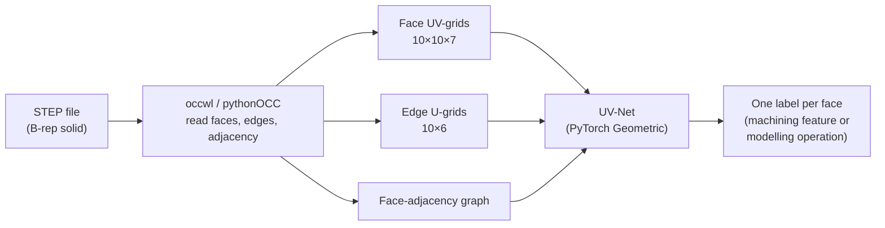
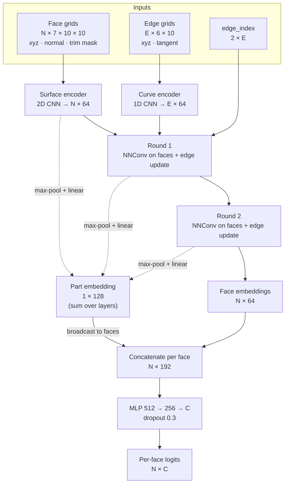
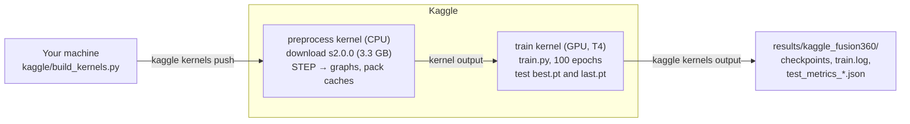
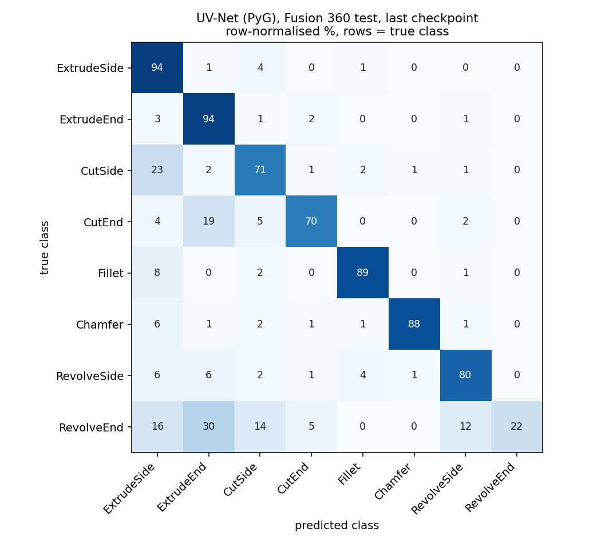

# UV-Net on PyTorch Geometric

A re-implementation of [UV-Net](https://arxiv.org/abs/2006.10211) (Jayaraman et al., CVPR 2021) using
**PyTorch Geometric** instead of DGL, set up for **machining-feature segmentation on the
[MFCAD++](https://pure.qub.ac.uk/en/datasets/mfcad-dataset-dataset-for-paper-hierarchical-cadnet-learning-from)
dataset**. It runs on NVIDIA GPUs (CUDA), on Apple-silicon GPUs (MPS), and on CPU.

It also trains on **Fusion 360 Gallery segmentation**, with Kaggle kernels for a full GPU run.

| Dataset | Task | Test per-face accuracy | Test mean IoU | Reference |
|---|---|---|---|---|
| MFCAD++ | 25 machining-feature classes | **99.00%** | **0.968** | UV-Net, published: 99.49% |
| Fusion 360 Gallery (s2.0.0) | 8 modelling-operation classes | **89.13%** | **0.677** | UV-Net re-run in the BRT paper: 89.03% / 0.665 |

Details in [Results](#results) and [`docs/results.md`](docs/results.md).



## What the code does

CAD models are stored as **B-reps** (boundary representations): a solid is a set of faces (surfaces), joined
along edges (curves). UV-Net learns directly from this structure instead of converting the part to a mesh or a
point cloud.

1. **Sample the geometry on UV-grids** (`process/step_to_pyg.py`).
   - **Faces:** each face is a patch of a parametric surface S(u, v). The code samples a regular 10×10 grid
     in the (u, v) domain and stores 7 channels per sample: the 3D point, the surface normal, and a trim
     mask. The mask is 1 where the sample lies on the real, trimmed face and 0 where it falls in a
     cut-away region, such as inside a hole.
   - **Edges:** each edge is a curve C(u). The code samples 10 points along it, with 6 channels per sample:
     the point and the tangent.
2. **Build the face-adjacency graph.** Each face becomes a node. Each B-rep edge shared by two faces becomes
   a pair of directed graph edges. The part is centered and scaled to fit [−1, 1]³.
3. **Read the labels.** MFCAD++ stores each face's machining-feature class (0–24: chamfer, through hole,
   blind hole, pocket, slot, step, …, stock) as the name of its `ADVANCED_FACE` entity in the STEP file.
   The script reads these, so every face gets a label.
4. **Encode.**
   - A small **2D CNN** turns each face grid into a 64-d vector.
   - A **1D CNN** turns each edge grid into a 64-d vector.
5. **Message passing.** A graph neural network passes information between neighbouring faces. It uses
   edge-conditioned convolutions (`NNConv`), so the edge geometry shapes each message, and the edge
   features are updated from their two faces after every round. Two rounds produce 64-d per-face
   embeddings. Each layer's face features are max-pooled over the part, projected to 128-d and summed,
   which gives a global embedding of the part.
6. **Classify each face.** Each face's embedding is joined with the global embedding, and an MLP predicts
   one of the 25 classes (8 for Fusion 360). This is **face segmentation**: every face of the part gets
   its own label.

### Model at a glance

Shapes are per part: `N` faces, `E` directed edges (each B-rep edge gives two), `C` classes.



One round of message passing updates every face `f` from its neighbours `N(f)`, then every edge from its two
faces (Eqs. 1 and 2 of the paper):

$$h_f^{(\ell+1)} = \sigma\Big(\mathrm{BN}\Big(\mathrm{MLP}\Big(\sum_{f' \in \mathcal{N}(f)} W\big(g_{ff'}^{(\ell)}\big)\,(1+\epsilon)\,h_{f'}^{(\ell)}\Big)\Big)\Big)$$

$$g_{ff'}^{(\ell+1)} = \sigma\Big(\mathrm{BN}\Big(\mathrm{MLP}\big((1+\epsilon')\,g_{ff'}^{(\ell)} + P\,h_f^{(\ell+1)} + P\,h_{f'}^{(\ell+1)}\big)\Big)\Big)$$

`W(·)` is a linear layer that turns each edge embedding into a 64 × 64 weight matrix (this is `NNConv`),
`P` is a linear projection, `ε` and `ε'` are learned scalars, and `σ` is a leaky ReLU.

The model has 1.37M parameters. The architecture and hyperparameters match the original UV-Net; only the
graph library changes:

| Original (DGL) | This repo (PyG) |
|---|---|
| `NNConv(aggregator_type="sum", bias=False)` | `NNConv(aggr="add", root_weight=False, bias=False)` |
| `MaxPooling()` | `global_max_pool(h, batch)` |
| `dgl.batch` | `torch_geometric.loader.DataLoader` |

## Repository layout

```
uvnet_pyg/encoders.py       surface 2D-CNN, curve 1D-CNN, graph encoder (PyG)
uvnet_pyg/models.py         UVNetSegmenter (per-face classifier) + batch-shape bucketing for MPS
datasets/mfcadpp.py         dataset of preprocessed graphs, packed/memory-mapped cache, rotation augmentation
process/step_to_pyg.py      STEP files -> PyG graphs with UV-grid features and labels (multiprocess)
process/make_toy_dataset.py tiny synthetic MFCAD++-style dataset for a quick smoke test
datasets/fusion360.py       Fusion 360 Gallery segmentation: same graph format, 8 modeling-operation classes
process/fusion360_to_pyg.py Fusion 360 Gallery s2.0.0 (labels in .seg files) -> PyG graphs + split.json
kaggle/                     script kernels that preprocess and train on Fusion 360 Gallery on a Kaggle GPU
train.py                    training / testing (accuracy, per-class IoU, TensorBoard, checkpoints, resume)
analysis/                   error analysis of trained runs: confusions, renders of wrong faces, topology probe
docs/                       results, a write-up of how this port was built, figures (docs/fig/)
experiments/                run records: the full MFCAD++ run's setup, per-class results and notes
```

## Installation

You need [conda](https://docs.conda.io/en/latest/miniconda.html) (Miniconda or Miniforge). OpenCascade (the
CAD kernel used to read STEP files) is only practical to install through conda-forge.

```bash
git clone https://github.com/aumrawal/UV-Net-PyGeometric.git
cd UV-Net-PyGeometric

conda env create -f environment.yml
conda activate uvnet_pyg
pip install --no-deps git+https://github.com/AutodeskAILab/occwl.git
```

Check that it worked:

```bash
python -c "import torch, torch_geometric, OCC, occwl; print(torch.__version__, torch.cuda.is_available(), torch.backends.mps.is_available())"
```

**Notes by platform:**
- **Apple silicon (M1–M4):** works as is. The GPU is used through MPS.
- **Linux with an NVIDIA GPU:** make sure the PyTorch in the env is a CUDA build. If
  `torch.cuda.is_available()` prints `False`, reinstall PyTorch from conda-forge with a CUDA variant, for
  example `conda install -c conda-forge "pytorch=*=cuda*"`.
- **CPU only:** works everywhere, but full training is slow.
- **Don't mix installers:** install PyTorch from conda-forge, not pip. The pip wheel plus conda-forge
  OpenCascade loads two OpenMP runtimes and crashes with `OMP: Error #15`.

## Quick check: synthetic data (~2 minutes, no download)

This generates 120 simple parts (a block with holes and pockets, labelled the way MFCAD++ is), converts
them, and trains for a few seconds:

```bash
python process/make_toy_dataset.py data/toy_step --num 120
python process/step_to_pyg.py data/toy_step data/toy_processed
python train.py train --data_dir data/toy_processed --epochs 15 --batch_size 16 --experiment_name toy
python train.py test  --data_dir data/toy_processed --checkpoint results/toy/<run>/best.pt
```

You should see validation accuracy climb to around 100%.

## Training on MFCAD++

### 1. Get the data

Download `MFCAD_dataset.zip` (1.5 GB) in a browser from the
[MFCAD++ dataset page](https://pure.qub.ac.uk/en/datasets/mfcad-dataset-dataset-for-paper-hierarchical-cadnet-learning-from)
(licence CC BY). The site blocks scripted downloads. Unzip it anywhere. You should see:

```
MFCAD++_dataset/
  step/train/*.step  step/val/*.step  step/test/*.step
  train.txt  val.txt  test.txt  feature_labels.txt
```

### 2. Preprocess, once

```bash
python process/step_to_pyg.py /path/to/MFCAD++_dataset data/processed --num_processes 8
```

- Set `--num_processes` to your CPU core count.
- It takes about 20 minutes on a 10-core laptop and about 4 GB of disk.
- It uses the official split and writes one graph per model to `data/processed/graphs/`. Files that
  can't be processed are listed in `failures.json` (20 of 59,665).
- The step can be resumed: re-running it skips models that already exist.
- To try a subset first, add `--limit 2000`, which keeps the first 2,000 models of each split.

### 3. Train

```bash
python train.py train --data_dir data/processed --epochs 100 --batch_size 64 --experiment_name mfcadpp
```

- **Cache:** the first run packs each split into `data/processed/cache/<split>.pt` (about 4 GB total). Later
  runs load that file in seconds.
- **Outputs:** checkpoints (`best.pt`, lowest validation loss; `last.pt`) and TensorBoard logs are written
  to `results/<experiment>/<timestamp>/`. View the curves with `tensorboard --logdir results`.
- **Interrupted?** Continue with `--resume results/<experiment>/<timestamp>/last.pt`.
- **Hardware needs:** 100 epochs took about 13–15 hours on an Apple M4 MacBook Air (8-core GPU), and should be much
  faster on a recent NVIDIA GPU. It needs about 7 GB of RAM/unified memory at batch size 64. Lower
  `--batch_size` if memory is tight.

### 4. Test

```bash
python train.py test --data_dir data/processed --checkpoint results/mfcadpp/<timestamp>/best.pt
```

This prints per-face accuracy, mean IoU and per-class IoU, and writes `test_metrics.json` next to the
checkpoint.

### Useful options

| Flag | What it does |
|---|---|
| `--device cuda\|mps\|cpu` | Force a device (default: CUDA, then MPS, then CPU) |
| `--random_rotate` | Augment with random 90° rotations |
| `--max_train_samples N` | Train on the first N models only |
| `--val_split train` | Validate on the training set, e.g. for an overfitting check with `--max_train_samples 64 --max_val_samples 64` |
| `--save_every N` | Also keep a checkpoint every N epochs as `epoch_NNN.pt` (default 10; 0 keeps only `best.pt` and `last.pt`) |
| `--pad_nodes 0` | Turn off batch-shape bucketing (on by default on MPS only; see below) |
| `--lr`, `--batch_size`, `--epochs`, `--seed` | The usual |

## Training on Fusion 360 Gallery segmentation

The [Fusion 360 Gallery segmentation dataset](https://github.com/AutodeskAILab/Fusion360GalleryDataset/blob/master/docs/segmentation.md)
(s2.0.0, 35,680 models) labels every face with the modeling operation that created it: ExtrudeSide,
ExtrudeEnd, CutSide, CutEnd, Fillet, Chamfer, RevolveSide or RevolveEnd. Labels come from
`breps/seg/<name>.seg`, one line per face in STEP order. The official file list only has train and test;
20 % of train is held out for validation with the same shuffle as UV-Net
(`train_test_split(random_state=42)`).

```bash
python process/fusion360_to_pyg.py /path/to/s2.0.0 data/fusion360_processed --num_processes 8
python train.py train --dataset fusion360 --data_dir data/fusion360_processed --epochs 100 --batch_size 64
python train.py test  --dataset fusion360 --data_dir data/fusion360_processed --checkpoint results/<experiment>/<timestamp>/best.pt
```

The model and hyperparameters are the same as for MFCAD++; only the label set (8 classes instead of 25)
and the label source differ.

### On Kaggle

The archive is 3.3 GB, so the full run is set up for Kaggle, which downloads it from Autodesk's bucket
directly. Kaggle script kernels are single files, so `kaggle/build_kernels.py` embeds the project source in
two of them:

```bash
python kaggle/build_kernels.py --user <kaggle username>      # add --smoke for a small 3-epoch check first
kaggle kernels push -p kaggle/build/preprocess    # CPU: download, STEP -> graphs in a micromamba env, pack caches
kaggle kernels push -p kaggle/build/train         # GPU (T4), once the first kernel has completed
kaggle kernels output <user>/euclid-uvnet-fusion360-train -p results/kaggle_fusion360
```



The training kernel reads the first kernel's output, runs `train.py` unchanged, tests `best.pt` and
`last.pt`, and keeps the whole run directory (checkpoints, `train.log`, `test_metrics_*.json`, TensorBoard)
as its output. `--tag <name>` builds the pair under separate slugs, for a re-run that must not replace the
output of the existing kernels.

## Why batch-shape bucketing on Apple GPUs?

On MPS, every new tensor shape triggers a kernel compile of about 0.5 s. Graph batches have a different
number of faces and edges at every step, so without a fix training is about 5× slower.

`UVNetSegmenter` therefore pads each batch up to multiples of 128 faces and 512 edges, using a disconnected
dummy graph whose outputs are thrown away.
- **Evaluation:** outputs are bit-identical to unpadded runs.
- **Training:** BatchNorm statistics also see a few percent of duplicated padding rows.

The padding is off by default on CUDA and CPU.

## Results

### MFCAD++

| | Test per-face accuracy | Test mean IoU |
|---|---|---|
| This repo (best validation checkpoint, epoch 51) | 99.00% | 0.968 |
| This repo (final checkpoint, epoch 100) | 98.96% | 0.966 |
| Published UV-Net on MFCAD++ (reported by BrepMFR) | 99.49% | – |

This was a single run: Adam, lr 1e-3, batch 64, 100 epochs, no augmentation, on an Apple M4. The weakest
classes are rectangular through slot (IoU 0.887), round (0.932) and blind hole (0.943). Full per-class
numbers and the training curve are in [`docs/results.md`](docs/results.md). How the port was built, and the
problems solved along the way, are in [`docs/summary.md`](docs/summary.md).

### Fusion 360 Gallery segmentation

Official test split: 5,360 parts, 77,064 faces. One run (seed 0) on a Kaggle T4, same recipe as MFCAD++.

| | Test per-face accuracy | Test mean IoU |
|---|---|---|
| This repo, final checkpoint (epoch 100) | **89.13%** | **0.677** |
| This repo, best validation-loss checkpoint (epoch 40) | 88.11% | 0.660 |
| UV-Net, re-trained in the BRT paper (Zou & Zhu 2025, Table 3) | 89.03% | 0.665 |

The UV-Net paper itself has no Fusion 360 segmentation table, so the BRT paper's re-run is the closest
published reference. Per-class IoU (%) on the test set:

| Class | This repo (last) | UV-Net, BRT re-run |
|---|---|---|
| ExtrudeSide | 86.4 | 84.9 |
| ExtrudeEnd | 86.4 | 85.7 |
| CutSide | 59.9 | 61.2 |
| CutEnd | 58.3 | 56.8 |
| Fillet | 79.7 | 79.0 |
| Chamfer | 79.7 | 80.4 |
| RevolveSide | 72.8 | 70.0 |
| RevolveEnd | 18.8 | 13.7 |
| **Mean** | **67.7** | **66.5** |

The hard classes are the same in both: most errors confuse cut faces with extrude faces, and RevolveEnd is
the rarest class.

#### Where the errors are: the confusion matrix



Each row is a true class and shows where its faces went, in percent of that class (raw counts in
[`docs/fig/fusion360_confusion.csv`](docs/fig/fusion360_confusion.csv)). Three patterns stand out:

- **Cut is read as extrude.** 23% of CutSide faces are predicted ExtrudeSide, and 19% of CutEnd faces are
  predicted ExtrudeEnd. The reverse is rare (4% and 2%). A cut and an extrude can leave faces of the same
  shape; what tells them apart is whether material was removed, which shows up mostly in the convexity of the
  edges around the face. UV-Net's edge grids hold points and tangents only, so it has to infer that angle. On
  the best checkpoint, 5,910 of the 9,164 test errors are extrude/cut confusions, and only 4.8% of those sit
  on faces whose geometric twin in the same part carries the other label, so most of this is not ambiguous
  labelling.
- **The model favours the frequent classes.** ExtrudeSide is half of all test faces (39,495 of 77,064). When
  a face is unclear, the model leans that way: Fillet, Chamfer and RevolveSide each lose 6 to 8% of their
  faces to it.
- **RevolveEnd is barely learned.** It has 73 test faces and is recognised 22% of the time; 30% go to
  ExtrudeEnd, another flat end face.

Recall and precision per class (last checkpoint):

| Class | Test faces | Recall (%) | Precision (%) |
|---|---|---|---|
| ExtrudeSide | 39,495 | 94.3 | 91.1 |
| ExtrudeEnd | 12,223 | 94.1 | 91.3 |
| CutSide | 9,799 | 70.8 | 79.5 |
| CutEnd | 1,904 | 70.4 | 77.2 |
| Fillet | 7,094 | 88.6 | 88.8 |
| Chamfer | 2,181 | 87.8 | 89.6 |
| RevolveSide | 4,295 | 80.1 | 88.8 |
| RevolveEnd | 73 | 21.9 | 57.1 |

To draw the matrix for your own run, save the test predictions with
[`analysis/dump_logits.py`](analysis/dump_logits.py) and run:

```bash
python analysis/confusion_compare.py path/to/test_predictions.npz --key last \
    --out confusion.png --csv confusion.csv
```

The `.npz` needs the true labels `y` and either `pred_<key>`, `prob_<key>` or `logits`. Add
`--other run_b.npz --other_label "Run B"` (or a CSV of counts) to draw a second run next to the first, plus a
panel with the difference. The script also prints recall, precision and the five largest confusions. The
other scripts in [`analysis/`](analysis/) render the misclassified faces and compare runs.

Trained checkpoints are not included in this repository.

## Credits and citation

This is a port of the official [UV-Net code](https://github.com/AutodeskAILab/UV-Net) (MIT, © Autodesk).
Geometry sampling uses [occwl](https://github.com/AutodeskAILab/occwl) and
[pythonocc-core](https://github.com/tpaviot/pythonocc-core). If you use this, please cite UV-Net and the
dataset you train on (MFCAD++, or Fusion 360 Gallery via BRepNet, which introduced the segmentation set):

```bibtex
@inproceedings{jayaraman2021uvnet,
  title     = {UV-Net: Learning from Boundary Representations},
  author    = {Jayaraman, Pradeep Kumar and Sanghi, Aditya and Lambourne, Joseph G. and Willis, Karl D.D.
               and Davies, Thomas and Shayani, Hooman and Morris, Nigel},
  booktitle = {CVPR},
  year      = {2021}
}
@article{colligan2022hierarchical,
  title   = {Hierarchical CADNet: Learning from B-Reps for Machining Feature Recognition},
  author  = {Colligan, Andrew R. and Robinson, Trevor T. and Nolan, Declan C. and Hua, Yang and Cao, Weijuan},
  journal = {Computer-Aided Design},
  volume  = {147},
  year    = {2022}
}
@inproceedings{lambourne2021brepnet,
  title     = {BRepNet: A Topological Message Passing System for Solid Models},
  author    = {Lambourne, Joseph G. and Willis, Karl D.D. and Jayaraman, Pradeep Kumar and Sanghi, Aditya
               and Meltzer, Peter and Shayani, Hooman},
  booktitle = {CVPR},
  year      = {2021}
}
```

## License

MIT. See [`LICENSE`](LICENSE). This includes the original Autodesk copyright notice.
